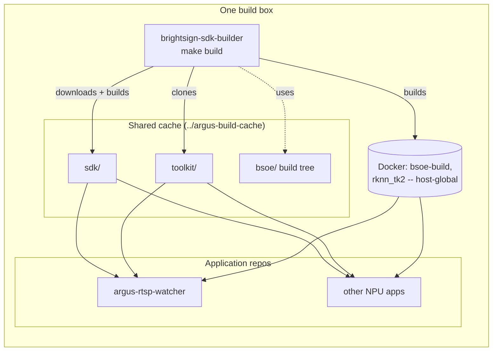
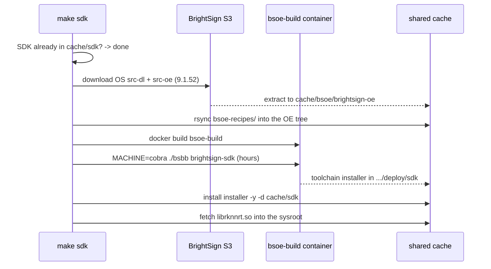
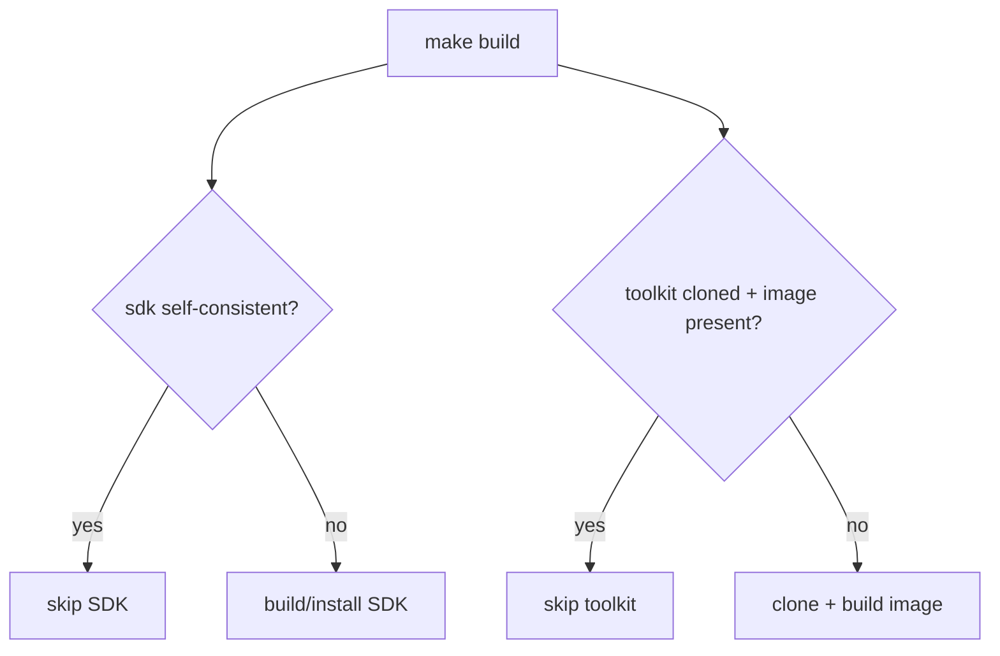

# brightsign-sdk-builder -- Design

Architecture and rationale for the build-box provisioner. For usage, see the
[README](../README.md).

## The problem

Cross-compiling a BrightSign NPU application needs three heavyweight assets:

1. A **custom aarch64 cross-compile SDK** whose sysroot contains OpenCV, the
   GStreamer RTSP plugins, the ext-bundle runtime, and the Rockchip libraries.
2. The **RKNN model toolkit** (`rknn-toolkit2` + `rknn_model_zoo`) used to
   quantize and compile models.
3. The **`rknn_tk2` Docker image** that runs the model compiler.

None of these can be downloaded ready-made. BrightSign publishes the OS *source*
but no prebuilt SDK, and the SDK must be a *custom* one -- a stock SDK lacks
OpenCV and the GStreamer pieces the engine links against. Building it is slow
(~hours) and large (~25 GB), and the result is identical for every consumer
project. Reproducing that in each application repo wastes hours per repo and
couples the repos together.

## The solution

One repo owns the heavyweight work and runs **once per build box**, writing its
outputs to a **shared cache outside any repo**. Application repos
(e.g. `argus-rtsp-watcher`) resolve the same cache by convention and read from it;
they never build the SDK, clone the toolkit, or build the `rknn_tk2` image
themselves. No application repo depends on another application repo.



## The shared-cache contract

`scripts/lib/cache.sh` is the single source of truth for the cache location and
is copied, unchanged in its resolution rules, into every participating repo. All
copies agree because they use the same default and the same override variable:

- Default: `<repo>/../argus-build-cache` (parallel to the checkout). Every sibling
  under a common parent resolves to the same absolute path.
- Override: `ARGUS_CACHE_DIR` (absolute recommended; a relative value resolves
  against the repo root). Normalized with `realpath -m` so the path baked into the
  SDK contains no unresolved `..`.

| Path | Written by | Read by |
|------|-----------|---------|
| `<cache>/sdk/` | this repo | consumers' engine/library/mosquitto builds |
| `<cache>/toolkit/` | this repo | consumers' model compilation |
| `<cache>/bsoe/` | this repo | this repo only (OS source + OE build tree) |
| `rknn_tk2`, `bsoe-build` images | this repo | the Docker daemon (host-global) |

Consumers additionally write `<cache>/models/` (their own compiled models); this
repo does not touch it.

### Why the SDK must live at one stable absolute path

OE SDK installers bake absolute paths into the extracted tree at install time:
`SDKTARGETSYSROOT`, `PATH`, the `--sysroot=` flags in `CC`/`CXX`, and even the ELF
`INTERP`/`RPATH` of the cross-toolchain binaries. A single install relocated with
`-d <cache>/sdk` is therefore correct for *every* consumer, because they all
resolve that same path. Copying in an SDK relocated for a different path
reintroduces stale paths and fails with "cannot execute: required file not found".
`sdk_is_self_consistent` guards against this by checking the baked
`SDKTARGETSYSROOT` matches the cache path.

## The SDK build



Every step short-circuits if its output already exists, so re-running `make build`
on a provisioned box is cheap. If a prebuilt installer is already in the cache (or
the OE deploy dir), the download and multi-hour build are skipped and only the
install step runs.

### The recipe layer (`bsoe-recipes/meta-bs`)

This Yocto layer is what makes the SDK *custom*. It is merged into the OS source
tree before the build and adds to the SDK sysroot:

- **OpenCV 4.5.5** (`recipes-open/opencv/`) and its `ade` dependency, with the
  Rockchip/ffmpeg build patches.
- **GStreamer RTSP plugins** and `plugins-base/good/bad` bbappends
  (`recipes-multimedia/gstreamer/`, `recipes-open/gstreamer-rtsp-plugins/`).
- **ext-bundle** (`recipes-multimedia/ext-bundle/`) -- the packaged GStreamer
  runtime payload consumers unpack.
- **libwebsockets** and **libpng** adjustments.
- **`brightsign-sdk.bb`** -- the recipe that defines what the SDK image contains.

Changing what lands in the SDK sysroot means editing this layer and rebuilding.

## The toolkit provisioning

`make toolkit` is lighter: shallow-clone `rknn-toolkit2` and `rknn_model_zoo`
(pinned to `RKNN_TAG`, default `v2.3.0`) into `cache/toolkit`, then build the
`rknn_tk2` image from the toolkit's own Dockerfile if the host does not already
have it. Consumers compile their models against this clone and image.

## Idempotency and reset



| Command | Effect |
|---------|--------|
| `make clean` | Remove `cache/bsoe` (the ~20 GB OE build tree); keep the installed SDK + toolkit |
| `make cache-clean` | Remove the entire shared cache -- affects every consumer repo |
| `docker rmi rknn_tk2 bsoe-build` | Remove the shared, host-global Docker images |

## Versioning

`BRIGHTSIGN_OS_VERSION` (default `9.1.52`) selects the OS source and the resulting
toolchain version; `RKNN_TAG` (default `v2.3.0`) pins the toolkit and the
`librknnrt.so` runtime. Keep `RKNN_TAG` identical to the value consumers compile
models with, so runtime, API headers, and compiled models stay compatible.

## Troubleshooting

### `do_install` fails with `rmdir ... gstreamer-1.0: No such file or directory`

The BrightSign OS source ships its own version-specific bbappends under
`meta-bs/recipes-open/`. When a recipe in `bsoe-recipes/` adds a
`do_install:append` that duplicates what an OS-shipped bbappend already does,
both run and collide — e.g. two appends each removing
`${datadir}/gstreamer-1.0`: the first succeeds, the second's unguarded `rmdir`
fails on the now-missing directory and aborts the task.

Diagnose from the on-disk build tree (kept in the cache after a failure):

```bash
# the concatenated do_install that actually ran
cat <cache>/bsoe/brightsign-oe/build/tmp-glibc/work/aarch64-oe-linux/<recipe>/*/temp/run.do_install.*
# every bbappend targeting that recipe (OS-shipped + ours)
find <cache>/bsoe/brightsign-oe -path '*/build/*' -prune -o -name '<recipe>*.bbappend' -print
```

Fix: drop the duplicated step from our bbappend and let the OS recipe own it.
This is the main risk when retargeting the recipe layer to a new OS version.

### `mkdir: cannot create directory '/srv/tftp//cobra': Permission denied`

After the SDK itself builds, `bsbb` tries to publish boot images to
`/srv/tftp/${USER}/${MACHINE}` (its `DEPLOY_FOR_TFTPBOOT` default). That path is
not mounted or writable in the container and is irrelevant to an SDK build, so the
build aborts at the very end even though the installer was produced. `build-sdk.sh`
passes `DEPLOY_FOR_TFTPBOOT=0` to disable the publish. (If a prior run already
produced the installer under `deploy/sdk/`, the next `make sdk` installs it
directly and skips the container entirely.)

### Re-running after a failure

bitbake caches completed tasks in sstate, so re-running `make sdk` after a fix
resumes near the failure rather than rebuilding from scratch — only recipes whose
signatures changed (e.g. an edited bbappend) re-run.

## Decision log

- 2026-10-02 -- Split the SDK/toolkit provisioning out of the application repos
  into this dedicated repo so application repos are standalone and share one
  per-box build of the expensive assets. Target the BrightSign 9.1 series
  (9.1.52), confirmed downloadable as OS source from BrightSign S3.
